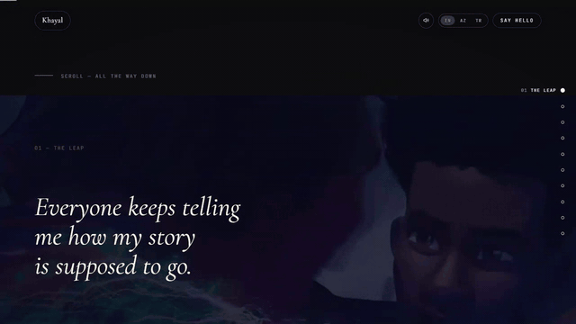
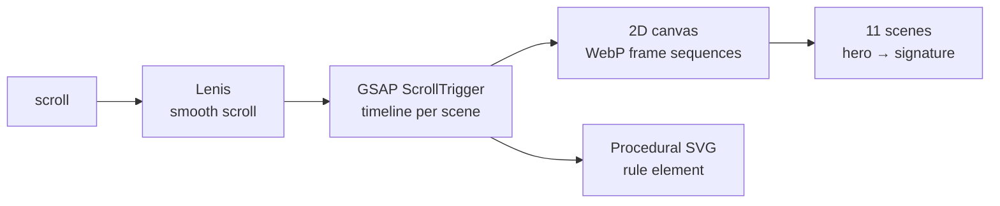
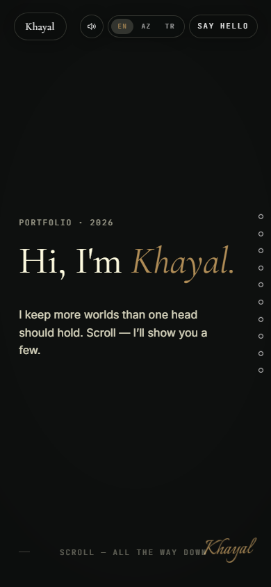

<h1 align="center">Khayal — Hypnos.dev</h1>

<p align="center">
  <a href="https://hypnosdev.vercel.app">
    
  </a>
</p>

<p align="center"><sub>Live capture of the real build — 2095 KB, loops forever.</sub></p>

Personal site: **11 scenes, many worlds, one head.**

Four scroll-driven "video" chapters rendered from WebP frame sequences
(Spider-Verse · CMBYN hands · Merli · Arcane), a procedural SVG rule, film-grade
motion — all hand-written. No 3D library, no page builder.

## Stack

- Vite + React 19 + TypeScript
- GSAP (ScrollTrigger) + Lenis smooth scroll
- 2D-canvas frame sequences (FFmpeg-generated WebP, scroll-scrubbed)
- Zero runtime dependencies beyond React + GSAP — JS ~135 KB gzip

## Develop

```bash
bun install
bun run dev
```

## Build & verify (before every push)

```bash
bun run build                                   # tsc --noEmit + vite build
bun run preview -- --port 5174 --strictPort &   # server
node tools/verify-v5.mjs http://localhost:5174/ # 28 checks → must be PASS
bun run test:contact                            # contact API guard tests
```

## Structure

```
src/lib/sequence.ts   scroll-scrub video frames (poster-first, decode-ahead)
src/lib/scroll.ts     world driver — one writer, 11 scenes
src/lib/perf.ts       fixed performance config (DPR 1, adaptive tier)
src/lib/i18n.ts       all copy — EN / AZ / TR
src/sections/         one file per scene
public/*/frames-*     frame tiers: leap 1440/960 · sapere 1440/1280 ·
                      counterweight 1440/1280 · speak 1280/854
api/contact.ts        contact form → Resend (honeypot + length caps + IP limit)
tools/                CDP verification + API guard tests
```

## Deploy

Vercel — builds from source on push. `main` = production; other branches get
preview URLs. AI workflow + untouchables: `AGENTS.md`.

---

## Architecture



## Screenshots

| Desktop | Mobile |
| :---: | :---: |
|  |  |

## FAQ

<details>
<summary><b>How is the scroll-driven video made?</b></summary>

Not with a `<video>` element. Each chapter is a sequence of WebP frames drawn onto a 2D canvas, and the scroll position picks which frame is shown. That is why it scrubs smoothly in both directions instead of buffering.

</details>

<details>
<summary><b>Why Lenis instead of native smooth scrolling?</b></summary>

`scroll-behavior: smooth` hijacks the scrollbar and breaks `position: sticky`. Lenis keeps native scroll — the scrollbar still works, sticky still works — and only interpolates the offset.

</details>

<details>
<summary><b>Where is the contact form handled?</b></summary>

An `api/contact.ts` function, with a separate guard test (`bun run test:contact`) so a broken endpoint fails in CI rather than in a visitor's inbox.

</details>

<details>
<summary><b>How is the build verified?</b></summary>

`bun run build` runs `tsc --noEmit` first, so a type error blocks the build. There is also a 28-check script (`tools/verify-v5.mjs`) that must pass before a push.

</details>

<details>
<summary><b>Why no 3D library?</b></summary>

The frame sequences are 2D canvas. A 3D library would have added weight for an effect that a pre-rendered sequence already delivers.

</details>

## Roadmap

- [ ] Move the frame sequences behind a CDN
- [ ] Add a reduced-motion path that skips the scrub
- [ ] Trim the remaining unused assets

<p align="center">
  <a href="https://hypnosdev.vercel.app"><b>Live site →</b></a>
</p>
