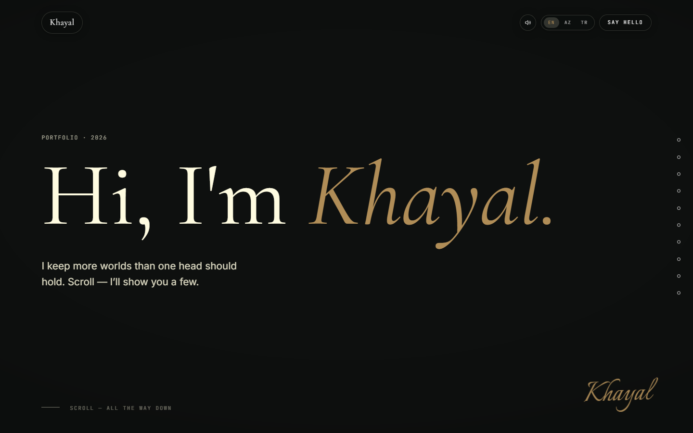

# Khayal — Hypnos.dev

Personal portfolio as an 11-scene scroll story — four scroll-scrubbed "video" chapters, procedural SVG, film-grade motion. No 3D library, no page builder.

**Live demo:** https://hypnosdev.vercel.app



## What it does

Eleven scenes are driven by one scroll writer: Lenis smooth scroll feeds GSAP ScrollTrigger timelines, one per scene. The four chapter "videos" are not `<video>` elements — each is a sequence of WebP frames (FFmpeg-generated, two resolution tiers per chapter) drawn onto a 2D canvas, with the scroll position picking the frame, so the scrub runs smoothly in both directions instead of buffering. A procedural SVG rule element runs alongside the frame sequences.

## Tech stack

Vite + React 19 + TypeScript · GSAP (ScrollTrigger) + Lenis · 2D-canvas WebP frame sequences · Resend for the contact API — JS ~135 KB gzip beyond React + GSAP.

## Features

- Scroll-scrubbed frame sequences with poster-first loading and decode-ahead (`src/lib/sequence.ts`); frame tiers at 1440/960 down to 1280/854 depending on chapter
- One scroll writer for 11 scenes (`src/lib/scroll.ts`), fixed performance config (DPR 1, adaptive tier) in `src/lib/perf.ts`
- Trilingual copy (EN / AZ / TR) in `src/lib/i18n.ts`
- Contact form as a Vercel function (`api/contact.ts`) with honeypot, length caps and IP rate limit, plus a guard test that fails CI if the endpoint breaks
- Build gate: `tsc --noEmit` blocks the build; a 34-check verification script (`tools/verify-v5.mjs`) must pass before every push

## Run locally

```bash
npm install
npm run dev
```

Build and verify (before every push):

```bash
npm run build                                     # tsc --noEmit + vite build
npx vite preview --port 5174 --strictPort
node tools/verify-v5.mjs http://localhost:5174/   # 34 checks → must be PASS
```

## What I learned

Choosing Lenis over `scroll-behavior: smooth` was load-bearing: native smooth scrolling hijacks the scrollbar and breaks `position: sticky`, while Lenis keeps native scroll and only interpolates the offset.
